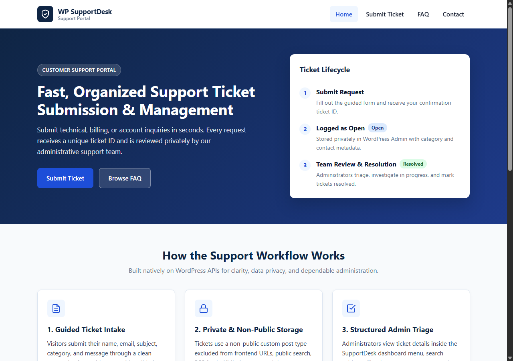
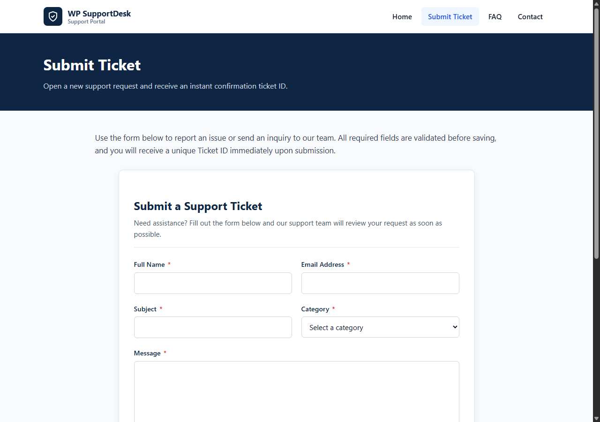
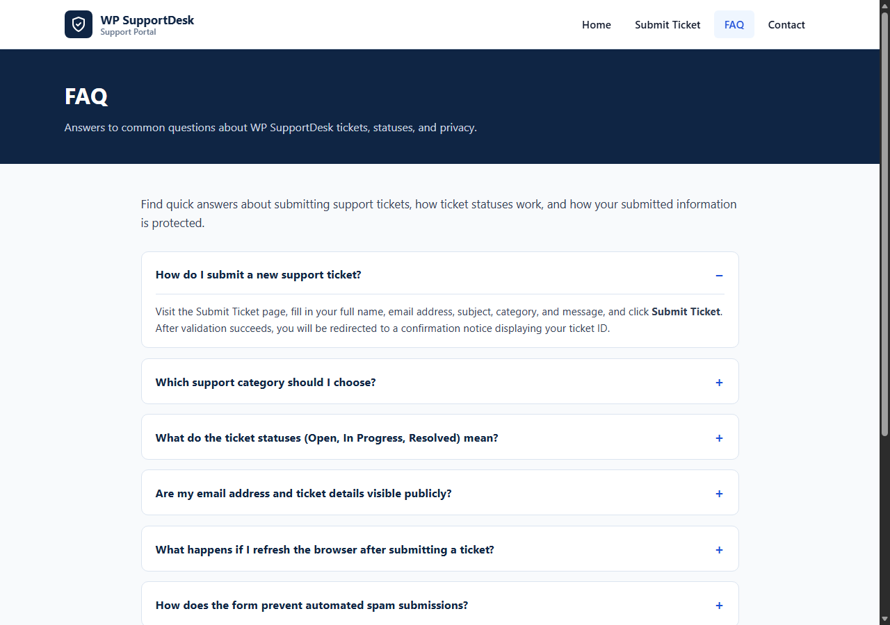
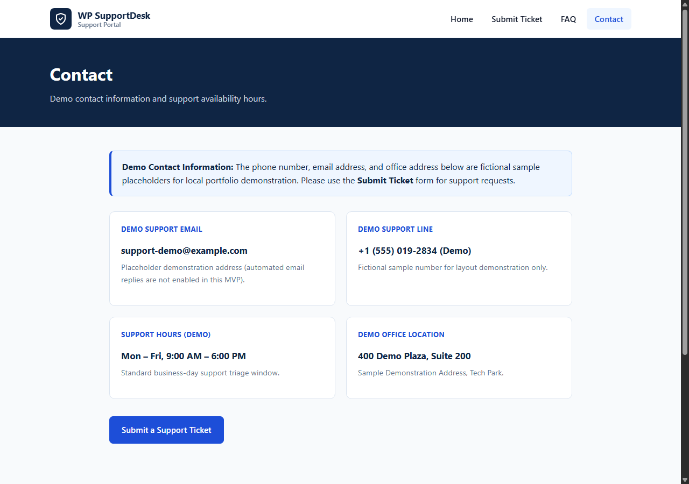
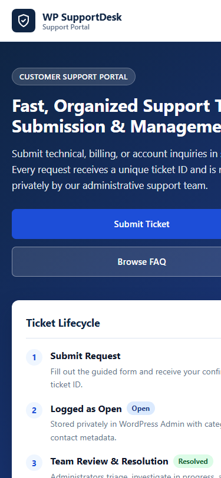

# WP SupportDesk — WordPress Support Ticket Management System & Portal

- **GitHub Repository:** [https://github.com/heyimankit/wp-supportdesk](https://github.com/heyimankit/wp-supportdesk)
- **Live Demo URL (Public HTTPS):** [https://strength-gzip-sublime-equation.trycloudflare.com/supportdesk/](https://strength-gzip-sublime-equation.trycloudflare.com/supportdesk/)
- **Local Development URL:** [http://localhost/supportdesk/](http://localhost/supportdesk/)
- **WordPress Admin:** [http://localhost/supportdesk/wp-admin/](http://localhost/supportdesk/wp-admin/)



WP SupportDesk is an end-to-end, beginner-friendly custom WordPress solution built for client support ticket intake and administrative ticket triage. The project consists of a **secure custom WordPress plugin** (`wp-supportdesk`) and a matching **lightweight custom theme** (`wp-supportdesk-theme`) styled with a clean corporate navy, blue, and white aesthetic.

---

## 1. Project Overview & Business Purpose

Small businesses, agencies, and SaaS startups frequently require a structured support portal where visitors and clients can submit inquiries without paying for heavyweight SaaS subscriptions (such as Zendesk or Freshdesk) or exposing private customer data.

WP SupportDesk provides:
1. **Public Intake Portal**: A dedicated **Submit Ticket** page featuring the `[supportdesk_form]` shortcode with accessible fields, server-side validation, spam protection, and safe redirect on submission.
2. **Support Information Hub**: Branded **Home**, **Submit Ticket**, **FAQ**, and **Contact** pages with mobile-responsive layouts.
3. **Private Ticket Management**: All tickets are stored in a non-public custom post type (`support_ticket`) and protected metadata (`wp_postmeta`), completely hidden from public queries, search engines, RSS feeds, XML sitemaps, and the WordPress REST API.
4. **Administrative Dashboard**: A dedicated **SupportDesk** admin menu in `wp-admin` where administrators can review ticket details, filter by status (`Open`, `In Progress`, `Resolved`) or category (`Technical Issue`, `Billing`, `Account Issue`, `Other`), search by subject, and execute individual or bulk status updates.

---

## 2. Technology Stack

- **Platform / CMS:** WordPress (6.x+)
- **Backend Language:** PHP (7.4+ / tested on PHP 8.2.12)
- **Database:** MySQL / MariaDB (using native WordPress tables `wp_posts` and `wp_postmeta`)
- **Frontend Presentation:** Semantic HTML5, CSS3 (CSS custom properties, CSS Grid, Flexbox), minimal vanilla JavaScript (double-click prevention, alert focus management, keyboard navigation)
- **Web Server:** Apache 2.4 (XAMPP)
- **Version Control:** Git

---

## 3. Project Structure

```text
wp-supportdesk/
├── .gitignore                                    # Excludes credentials, dumps, uploads, and logs
├── README.md                                     # Complete technical documentation, setup, and interview prep
├── docs/
│   └── screenshots/                              # Headless Edge portal screenshots
│       ├── 01_homepage.png                       # Desktop homepage with hero, lifecycle, and cards
│       ├── 02_submit_ticket.png                  # Submit ticket form with shortcode
│       ├── 03_faq.png                            # Accessible collapsible FAQ items
│       ├── 04_contact.png                        # Demo contact info and support hours
│       └── 05_mobile_homepage.png                # Mobile responsive view (375px)
└── wp-content/
    ├── plugins/
    │   └── wp-supportdesk/                       # Core SupportDesk WordPress plugin
    │       ├── wp-supportdesk.php                # Plugin bootstrap, constants, activation hooks
    │       ├── includes/
    │       │   ├── post-types.php                # Non-public CPT registration, status/category helpers
    │       │   ├── ticket-form.php               # Form processing on template_redirect, PRG redirect
    │       │   └── admin.php                     # Admin columns, filters, meta box, bulk actions
    │       ├── templates/
    │       │   └── ticket-form.php               # Accessible form template with error links
    │       └── assets/
    │           ├── css/
    │           │   ├── supportdesk.css           # Frontend form styles & focus outlines
    │           │   └── admin.css                 # Status pill badges & admin meta box styling
    │           └── js/
    │               └── supportdesk.js            # Vanilla JS for double-click lock & alert autofocus
    └── themes/
        └── wp-supportdesk-theme/                 # Lightweight custom portal theme
            ├── style.css                         # Theme metadata header
            ├── functions.php                     # Theme setup, nav menus, asset enqueuing
            ├── header.php                        # Branded header with responsive nav toggle
            ├── footer.php                        # Footer navigation and demo hours notice
            ├── front-page.php                    # Hero, lifecycle panel, feature cards, category cards
            ├── page.php                          # Clean standard layout for Submit Ticket, FAQ, Contact
            ├── index.php                         # Fallback blog archive with empty state
            ├── 404.php                           # Accessible Not Found template
            └── assets/
                ├── css/
                │   └── theme.css                 # Navy, blue, white responsive styling system
                └── js/
                    └── theme.js                  # Accessible mobile menu toggle with ESC key handler
```

---

## 4. Local Setup Instructions (XAMPP on Windows)

### Prerequisites
- [XAMPP for Windows](https://www.apachefriends.org/) with PHP 7.4+ or 8.x
- MariaDB running (configured on port `3307` or standard `3306`)

### Step-by-Step Setup
1. **Copy Files to XAMPP**:
   - Copy `wp-content/plugins/wp-supportdesk/` to `C:\xampp\htdocs\supportdesk\wp-content\plugins\wp-supportdesk\`.
   - Copy `wp-content/themes/wp-supportdesk-theme/` to `C:\xampp\htdocs\supportdesk\wp-content\themes\wp-supportdesk-theme\`.

2. **Database Configuration (`wp-config.php`)**:
   Ensure `C:\xampp\htdocs\supportdesk\wp-config.php` specifies the custom database port if MariaDB is on port 3307:
   ```php
   define( 'DB_NAME', 'wp_supportdesk' );
   define( 'DB_USER', 'root' );
   define( 'DB_PASSWORD', '' );
   define( 'DB_HOST', '127.0.0.1:3307' );
   ```

3. **Activate Theme & Plugin**:
   - In `/wp-admin/`, go to **Appearance -> Themes** and activate **WP SupportDesk Theme**.
   - Go to **Plugins -> Installed Plugins** and activate **WP SupportDesk**.

4. **Configure Pages & Menus**:
   - Go to **Pages -> Add New**:
     - **Home**: (blank or welcome text).
     - **Submit Ticket**: add shortcode `[supportdesk_form]`. Slug: `support`.
     - **FAQ**: add frequently asked questions. Slug: `faq`.
     - **Contact**: add demo contact information. Slug: `contact`.
   - Go to **Settings -> Reading**:
     - Set *Your homepage displays* to **A static page**.
     - Set *Homepage* to **Home**.
   - Go to **Appearance -> Menus**:
     - Create a menu named `Primary Navigation` with links to Home, Submit Ticket, FAQ, and Contact.
     - Assign to both the **Primary Navigation** and **Footer Navigation** display locations.

---

## 5. Request Flow: Form Submission to Admin Triage

```text
[ Visitor on /support/ ]
          │
          ▼
1. Loads [supportdesk_form] shortcode -> generates CSRF nonce & renders form template
          │
          ▼ (User fills form & clicks Submit Ticket)
2. HTTP POST sent to /support/
          │
          ▼
3. template_redirect hook intercepts request before HTML headers are sent:
   ├── Verify CSRF nonce (wp_verify_nonce -> 403 on failure)
   ├── Check honeypot field (wp_supportdesk_website -> 400 on failure)
   ├── Check IP transient rate limit (max 5 per 5 min -> 429 on failure)
   └── Sanitize inputs (sanitize_text_field, sanitize_email, is_email, sanitize_key)
          │
          ├── (If invalid) -> sets errors in wp_supportdesk_form_state(), renders inline error list
          │
          └── (If valid)
                   │
                   ▼
4. Database Persistence:
   ├── wp_insert_post() -> creates post_type='support_ticket', post_status='publish' in wp_posts
   └── update_post_meta() -> saves customer_name, customer_email, category, status='open' in wp_postmeta
          │
          ▼
5. Post/Redirect/Get (PRG) Pattern:
   ├── Sets temporary 120s notice token (wp_supportdesk_notice_<token> = ticket_id)
   └── wp_safe_redirect(/support/?supportdesk_notice=<token>) -> HTTP 302
          │
          ▼
6. Clean GET request renders green alert: "Your support ticket #XX has been submitted successfully."
   (Refreshing browser simply reloads notice without duplicate ticket creation!)
          │
          ▼
[ Admin in wp-admin/edit.php?post_type=support_ticket ]
   ├── Views Ticket ID, Subject, Customer Name, Email, Category, Status badge
   ├── Filters by Status (Open / In Progress / Resolved) or Category
   ├── Opens ticket -> inspects customer message in editor
   ├── Changes Status in Ticket Details & Status meta box -> clicks Update
   └── Status changes to In Progress / Resolved with instant badge update
```

---

## 6. Security & Data Protection Controls

- **Non-Public Custom Post Type (`support_ticket`)**:
  - `'public' => false`
  - `'publicly_queryable' => false`
  - `'exclude_from_search' => true`
  - `'show_in_rest' => false`
  - `'has_archive' => false`
  - `'rewrite' => false`
  - `'query_var' => false`
  - Filter `wp_sitemaps_post_types` explicitly excludes `support_ticket` from XML sitemaps.
  - Queries like `/?p=XX`, `/?post_type=support_ticket`, `/?s=ticket_subject`, and `/wp-json/wp/v2/support_ticket` never return private ticket content or customer email addresses.
- **CSRF Nonces**: `wp_nonce_field()` and `wp_verify_nonce()` are validated on every frontend submission and administrative meta box update.
- **Capability Checks**: Ticket editing and administrative triage are mapped to `manage_options`, preventing unauthorized subscribers or contributors from accessing or modifying tickets.
- **Sanitization & Escaping**: All inputs are sanitized using `sanitize_text_field()`, `sanitize_email()`, `sanitize_key()`, and `sanitize_textarea_field()`. Output is escaped with `esc_html()`, `esc_attr()`, `esc_url()`, and `absint()`.
- **Anti-Spam & Rate Limiting**: An invisible honeypot field catches automated bot scripts, while WordPress Transients API enforces a rate limit of 5 submissions per 5-minute rolling window per hashed IP address.
- **Direct File Access Block**: Every PHP file begins with `if ( ! defined( 'ABSPATH' ) ) { exit; }`.

---

## 7. Database Architecture (`wp_posts` & `wp_postmeta`)

Rather than maintaining rigid custom MySQL tables that require migration harnesses, WP SupportDesk relies on WordPress's native schema:

### `wp_posts` Table
| Column | Value in SupportDesk | Notes |
|---|---|---|
| `ID` | `24` | Unique generated Ticket ID |
| `post_type` | `support_ticket` | Non-public custom post type |
| `post_title` | `Portal Upgrade Verification Ticket` | Ticket subject |
| `post_content` | `Detailed issue description...` | Ticket message |
| `post_status` | `publish` | Managed privately in `wp-admin` |
| `post_date` | `2026-11-27 14:08:00` | Submission timestamp |

### `wp_postmeta` Table
| `meta_key` | Example `meta_value` | Purpose |
|---|---|---|
| `_wp_supportdesk_customer_name` | `LeadHeight Candidate` | Submitter full name |
| `_wp_supportdesk_customer_email` | `candidate@leadheight.com` | Customer email |
| `_wp_supportdesk_category` | `technical` | Normalized key: `technical`, `billing`, `account`, `other` |
| `_wp_supportdesk_status` | `resolved` | Status key: `open`, `in_progress`, `resolved` |

*Note: Meta keys begin with an underscore (`_`) so WordPress marks them as private, hiding them from default custom field UI.*

---

## 8. Automated Testing & Verification

The project includes an automated end-to-end test script executed directly against the live local XAMPP site (`http://localhost/supportdesk/`).

### Test Results (48/48 Passing Assertions)
```text
--- 1. Page Rendering & Custom Theme Navigation ---
[PASS] GET / returns HTTP 200
[PASS] GET / contains expected text: 'Fast, Organized Support Ticket Submission'
[PASS] GET / enqueues theme.css
[PASS] GET / contains navigation menu
[PASS] GET /support/ returns HTTP 200
[PASS] GET /support/ contains expected text: 'Submit a Support Ticket'
[PASS] GET /support/ enqueues theme.css
[PASS] GET /support/ contains navigation menu
[PASS] GET /faq/ returns HTTP 200
[PASS] GET /faq/ contains expected text: 'Find quick answers about submitting support tickets'
[PASS] GET /faq/ enqueues theme.css
[PASS] GET /faq/ contains navigation menu
[PASS] GET /contact/ returns HTTP 200
[PASS] GET /contact/ contains expected text: 'Demo Contact Information'
[PASS] GET /contact/ enqueues theme.css
[PASS] GET /contact/ contains navigation menu

--- 2. Shortcode & Form Accessibility ---
[PASS] Support page contains CSRF nonce field
[PASS] Support page contains honeypot field
[PASS] Support page enqueues supportdesk.css
[PASS] Support page enqueues supportdesk.js
[PASS] Extracted valid frontend nonce

--- 3. Validation & Spam Rejection ---
[PASS] Empty submission displays error list
[PASS] Empty name error is displayed
[PASS] Invalid email error is displayed
[PASS] Honeypot filled submission rejected with HTTP 400
[PASS] Invalid nonce submission rejected with HTTP 403

--- 4. Valid Ticket Submission & PRG Flow ---
[PASS] Valid submission returns HTTP 302 PRG redirect
[PASS] Redirect target contains supportdesk_notice token
[PASS] Confirmation page loads HTTP 200
[PASS] Confirmation displays generated Ticket ID (#24)
[PASS] Database: post_type is 'support_ticket'
[PASS] Database: post_title matches subject
[PASS] Database: customer_name stored in postmeta
[PASS] Database: customer_email stored in postmeta
[PASS] Database: category is 'technical'
[PASS] Database: initial status is 'open'
[PASS] Browser refresh does NOT duplicate ticket (Post/Redirect/Get works)

--- 5. Privacy & Data Protection ---
[PASS] Ticket data NOT leaked on /?p=24
[PASS] Ticket data NOT leaked on /?post_type=support_ticket
[PASS] Ticket data NOT leaked on /?s=Portal+Upgrade+Verification
[PASS] Ticket data NOT leaked on /?s=candidate@leadheight.com
[PASS] Ticket data NOT leaked on /wp-json/wp/v2/support_ticket
[PASS] Ticket data NOT leaked on /wp-sitemap.xml
[PASS] Ticket data NOT leaked on /?feed=rss2
[PASS] REST API endpoint /wp/v2/support_ticket returns 404 Not Found

--- 6. WordPress Admin Management & Status Updates ---
[PASS] Admin status updated to 'in_progress'
[PASS] Admin status updated to 'resolved'
[PASS] Pre-existing ticket #14 status preserved as 'resolved'

SUMMARY: 48 passed, 0 failed.
```

---

## 9. Visual Gallery (Screenshots)

| Page | Preview |
|---|---|
| **Portal Homepage** |  |
| **Submit Ticket Page** |  |
| **FAQ Page** |  |
| **Demo Contact Page** |  |
| **Mobile Responsive Layout** |  |

---

## 10. 90-Second Interview Explanation

> "I built **WP SupportDesk**, a complete WordPress support portal and ticket management system.
>
> On the frontend, I developed a lightweight custom theme styled in corporate navy and blue with responsive navigation, hero section, lifecycle steps, category quick-links, FAQ accordion items, and a demo contact page. The support intake form is powered by the `[supportdesk_form]` shortcode.
>
> When a user submits the form, it is processed on the `template_redirect` hook before headers are sent. I verify a WordPress CSRF nonce, check a honeypot field, enforce transient rate limiting, sanitize all inputs with functions like `sanitize_text_field()` and `sanitize_email()`, and create a private post using `wp_insert_post()` and `update_post_meta()`. I then redirect the browser using `wp_safe_redirect()` with a transient token—implementing the Post/Redirect/Get pattern so browser refreshes never duplicate tickets.
>
> For security, the custom post type is non-public with `show_in_rest => false` and `exclude_from_search => true`, ensuring customer emails and messages are never exposed on public URLs, site searches, or the REST API. In `wp-admin`, administrators have a dedicated SupportDesk menu with custom columns, status filter tabs, category dropdowns, subject search, and a meta box to update ticket status between Open, In Progress, and Resolved."

---

## 11. Key Files & Functions to Study

1. **`wp-content/plugins/wp-supportdesk/includes/post-types.php`**:
   - `wp_supportdesk_register_post_type()`: Non-public CPT arguments, capability mapping.
   - `wp_supportdesk_exclude_from_sitemaps()`: Sitemaps security filter.
   - `wp_supportdesk_count_tickets_by_status()`: Status counter for admin views.
2. **`wp-content/plugins/wp-supportdesk/includes/ticket-form.php`**:
   - `wp_supportdesk_handle_form_submission()`: Form processing on `template_redirect`, nonce verification, honeypot, transients rate limiting, sanitization, `wp_insert_post()`, `wp_safe_redirect()`.
   - `wp_supportdesk_render_ticket_form()`: Shortcode callback, output buffering with `ob_start()`.
3. **`wp-content/plugins/wp-supportdesk/includes/admin.php`**:
   - `wp_supportdesk_set_admin_columns()` & `wp_supportdesk_render_admin_column()`: Custom list table columns and colored status badges.
   - `wp_supportdesk_admin_status_views()`: Clickable status views (All, Open, In Progress, Resolved).
   - `wp_supportdesk_render_admin_filters()` & `wp_supportdesk_filter_admin_tickets()`: Status/category dropdowns and `pre_get_posts` meta query.
   - `wp_supportdesk_render_ticket_meta_box()` & `wp_supportdesk_save_ticket_meta()`: Meta box rendering and secure saving with capability/nonce checks.
4. **`wp-content/themes/wp-supportdesk-theme/functions.php` & `front-page.php`**:
   - Theme setup, navigation registration, fallback menu, and modular hero/card layout.

---

## 12. 15 WordPress / PHP Interview Questions & Answers

### 1. Why build this as a custom plugin instead of adding code to the theme's `functions.php`?
Functionality belongs in plugins; presentation belongs in themes. If ticket submission were inside `functions.php`, switching the theme would destroy all support ticket functionality.

### 2. Why use a Custom Post Type instead of a custom MySQL database table?
A Custom Post Type leverages WordPress's built-in `wp_posts` and `wp_postmeta` tables, `wp_insert_post()`, search, pagination, trash/restore, and admin UI without requiring raw SQL queries or custom database upgrade migrations.

### 3. What is the difference between an Action and a Filter in WordPress?
An **Action** (`add_action`) executes code at specific lifecycle hooks without expecting a return value (e.g. `init`, `template_redirect`, `admin_notices`). A **Filter** (`add_filter`) receives a value, modifies it, and must return it (e.g. `manage_support_ticket_posts_columns`, `views_edit-support_ticket`).

### 4. How does the `[supportdesk_form]` shortcode work?
`add_shortcode('supportdesk_form', 'wp_supportdesk_render_ticket_form')` binds the shortcode tag. The callback enqueues assets and uses PHP output buffering (`ob_start()` / `ob_get_clean()`) to capture `templates/ticket-form.php` and return HTML as a string.

### 5. Why process the form on `template_redirect` instead of inside the shortcode?
Shortcodes run while page HTML is already streaming. Calling `wp_safe_redirect()` inside a shortcode fails with a `"headers already sent"` error. `template_redirect` runs before any HTTP output, allowing clean Post/Redirect/Get redirects.

### 6. How is ticket data persisted in MySQL?
`wp_insert_post()` creates a record in `wp_posts` (`post_type = 'support_ticket'`, `post_title` = subject, `post_content` = message). `update_post_meta()` creates rows in `wp_postmeta` for customer name, email, category, and status.

### 7. How do Nonces and Capability checks differ?
A **Nonce** validates the *request origin* to prevent Cross-Site Request Forgery (CSRF). A **Capability check** validates *user authorization* (`current_user_can('manage_options')`) to prevent unauthorized users from performing administrative actions.

### 8. What is the difference between Sanitization and Escaping?
**Sanitization** cleans untrusted input before storage (e.g., `sanitize_email()`, `sanitize_text_field()`). **Escaping** encodes output right before rendering to prevent Cross-Site Scripting (XSS) (e.g., `esc_html()`, `esc_attr()`, `esc_url()`).

### 9. How do you keep tickets private from the public?
By configuring `support_ticket` with `'public' => false`, `'publicly_queryable' => false`, `'exclude_from_search' => true`, `'show_in_rest' => false`, and filtering `wp_sitemaps_post_types`.

### 10. How does the administrator change ticket status?
In `wp-admin`, the admin selects `Open`, `In Progress`, or `Resolved` in the side meta box and updates the post. `wp_supportdesk_save_ticket_meta()` checks autosave, nonce, and capabilities before updating `_wp_supportdesk_status` in `wp_postmeta`. Admins can also use Bulk Actions from the list table.

### 11. Why is `if ( ! defined( 'ABSPATH' ) ) exit;` necessary in every PHP file?
It prevents direct HTTP access to plugin files outside WordPress, which stops attackers from executing PHP scripts directly or viewing error traces.

### 12. Why wrap user input in `wp_slash()` before `wp_insert_post()`?
WordPress expects slashed data because it internally applies `wp_unslash()`. Passing unslashed data with backslashes (such as Windows file paths `C:\xampp`) would otherwise strip the backslashes.

### 13. How are CSS and JS assets loaded efficiently?
Frontend assets are enqueued on `wp_enqueue_scripts` only when `has_shortcode($post->post_content, 'supportdesk_form')` is true. Admin assets are enqueued on `admin_enqueue_scripts` only when `get_current_screen()->post_type === 'support_ticket'`.

### 14. What happens when the plugin is deactivated?
`register_deactivation_hook()` flushes rewrite rules without dropping posts or postmeta tables, ensuring zero data loss upon reactivation.

### 15. How can WP SupportDesk be extended with email notifications?
By hooking into the plugin's custom action `do_action('wp_supportdesk_ticket_created', $ticket_id, $ticket_data)`. An add-on can call `wp_mail()` without modifying the core plugin code.
